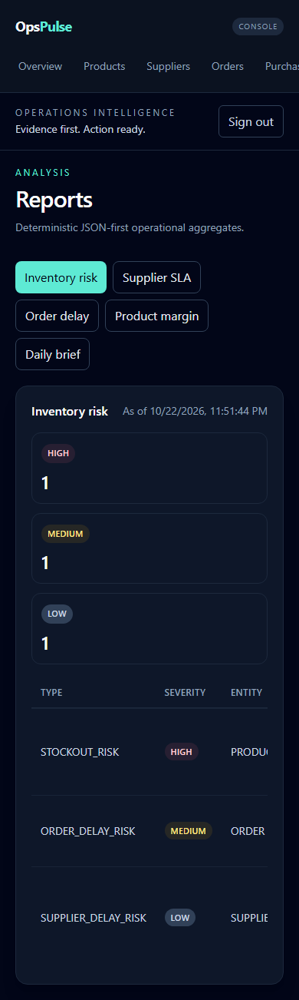
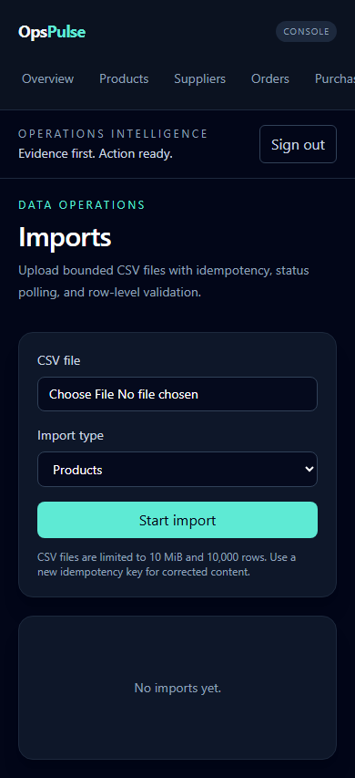
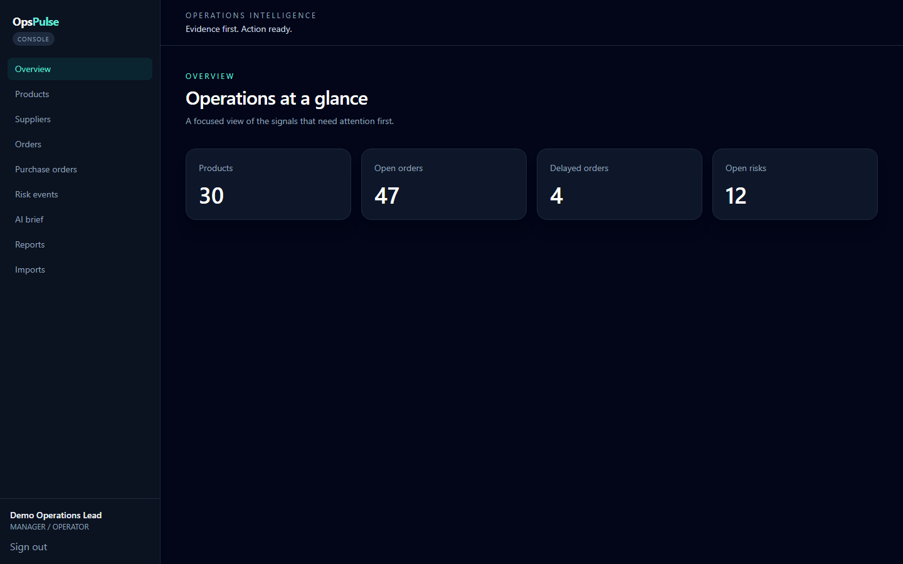

# PR #25 Visual and Responsive QA — 2026-10-22

Scope: isolated branch clone `codex/opspulse-hardening-20261022` on the authorized Windows workstation. This is **mock-mode UI verification**; no production service, database or credentials were used.

## Method

- Chromium Playwright, 390 × 844 (mobile), 768 × 1024 (tablet) and 1440 × 900 (desktop).
- Nine routes: dashboard, products, suppliers, orders, purchase orders, risks, AI brief, reports, imports.
- Total **27 route/viewport combinations**; checked `document.documentElement.scrollWidth` and `document.body.scrollWidth` against the viewport width.
- Captured and visually inspected screenshots for login, dashboard, risks, reports and imports at each viewport.
- Evaluated Dashboard, Reports and Imports with axe-core at all three widths.
- Checked four mobile Reports table variants for keyboard-focusable scroll areas and axe violations.

## Findings and remediation

- PASS: no page-level horizontal overflow across the 27 route/viewport combinations; the narrow mobile navigation and wide data tables intentionally scroll inside their own containers.
- PASS: Tailwind v4 styling, custom accent colors, dashboard cards, forms and reports remained visually legible at the sampled viewport sizes.
- FIXED: mobile Reports inventory table initially failed axe's `scrollable-region-focusable` rule. Report and import table containers now have semantic, labeled, keyboard-focusable scroll regions and a focus-visible outline.
- PASS: mobile report variants (Inventory risk, Supplier SLA, Order delay, Product margin) have focusable table regions with no axe violations after UI transitions settle.
- PASS: the original desktop accessibility scenario and the new mobile keyboard/axe scenario both pass.

## Verification gates

- [x] Frontend lint
- [x] Vitest unit suite, 17 tests
- [x] Production build
- [x] Playwright desktop and mobile accessibility checks
- [x] Visual audit at 390 / 768 / 1440 widths, nine routes each
- [ ] Production VIEWER-mode smoke after separately authorized deployment (out of scope)
- [ ] Real-user manual review of live Pages/Render deployment (out of scope)

Screenshots were captured locally under the isolated temporary clone during QA, **not** committed as misleading hosted/production evidence. Reproduce the checks with `VITE_USE_MOCKS=true` in Playwright and the tests under `frontend/e2e/`.
## Selected screenshots (mock data, not hosted production)

**Mobile reports, 390 px:** keyboard focusable scrollable data table.

**Mobile imports, 390 px:** form layout without document overflow.

**Desktop dashboard, 1440 px:** KPI layout and sidebar.
